# Kessler, every satellite above you, live

A live 3D map of about 19,500 satellites and pieces of debris, with a solar system to zoom out into. I designed and directed it, and Claude Code wrote the code. Live: https://adarshkhera.github.io/kessler/

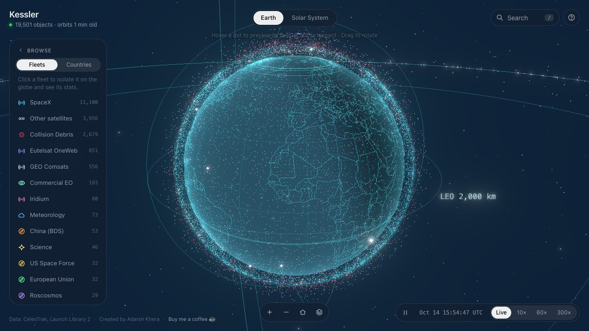

## The idea

I wanted a project that shows what I can do with live public data and a 3D view, and that a stranger understands in ten seconds. Satellites won because the data is free, the hierarchy is real (operator, constellation, satellite) and the story is easy to feel: the sky is crowded and a lot of it is debris. The name comes from the Kessler syndrome.

## Four rules

1. **Say what is real.** Positions are calculated from real orbits. Anything inferred or modelled is labelled on screen.
2. **Few controls.** One globe, a list of fleets, a search box and a clock.
3. **A filter is a promise.** Once you filter, hover and taps stay inside it.
4. **A phone is a real screen.**

## What it does

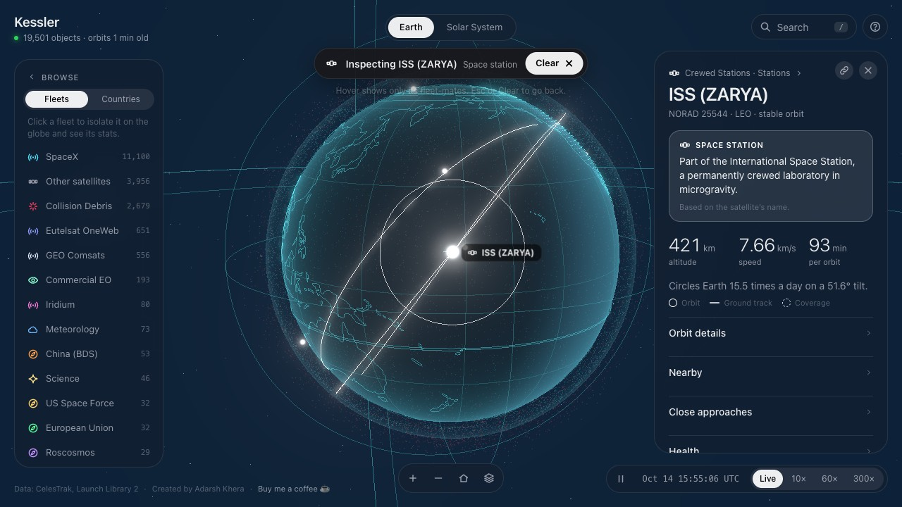
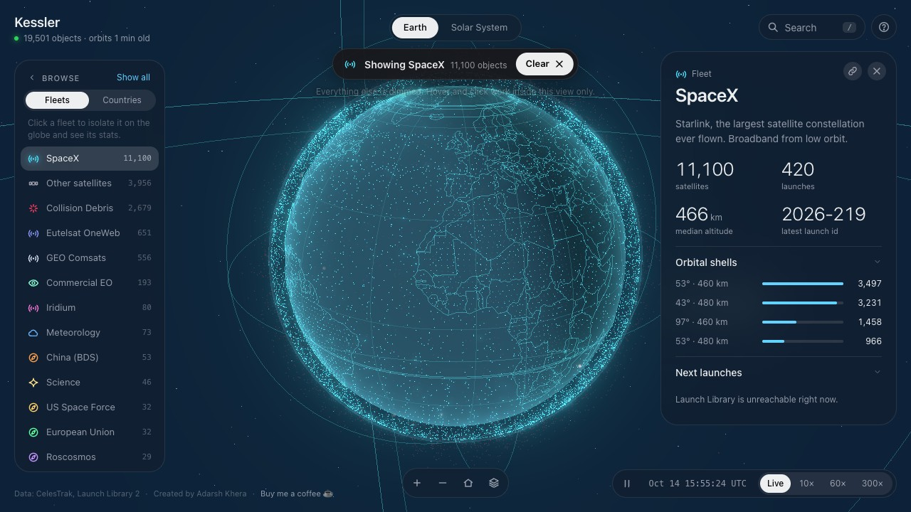
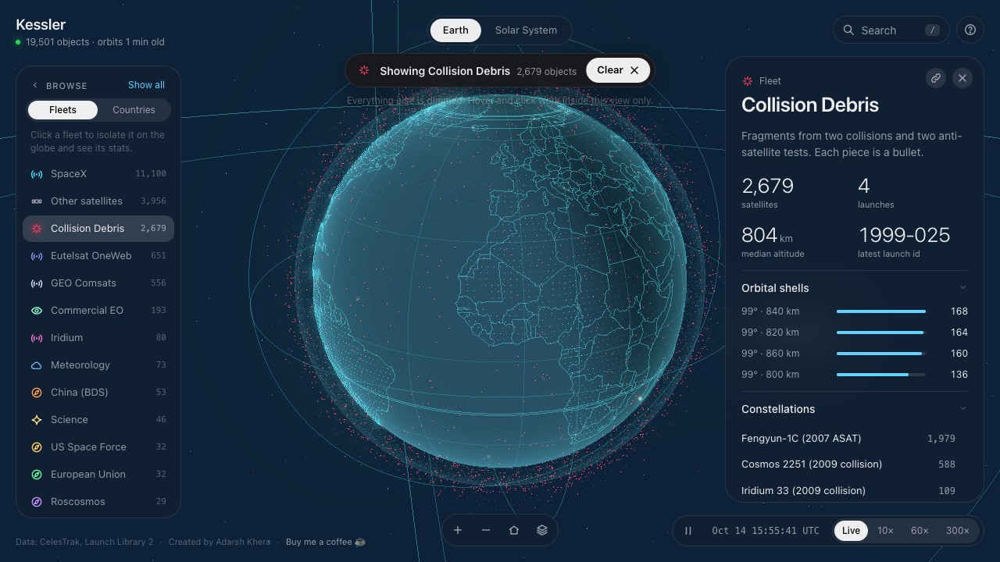
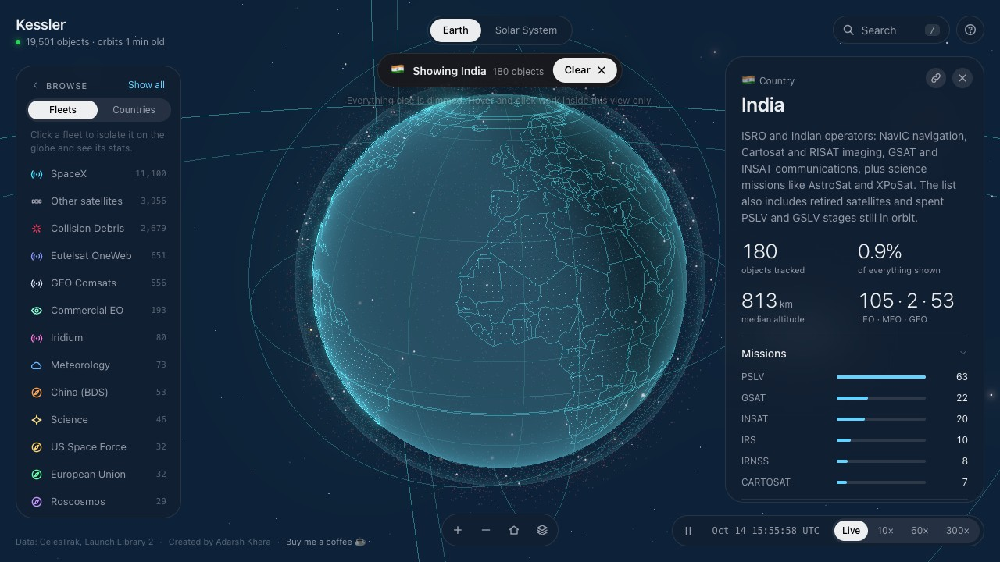

Click a satellite for what it is, what it is for in one line, how high and fast it is, what is nearby and what passes close in the next three hours. Group by fleet or by country.

## Six rounds of me being a user

1. It looked like a dashboard, so it became one globe with a few floating controls.
2. Nobody knew what to do, so: a welcome, a seven step tour and a guide.
3. The coloured dots meant nothing, so each fleet got a glyph for its job.
4. I could not tell what was filtered, so a bar says it, and hover stays inside the filter.
5. The collapsed nav was dots again, so it shows two letter badges.
6. The phone had no room: the mode switch became an icon, the filter bar went, the description became a small peek.

## Zooming out

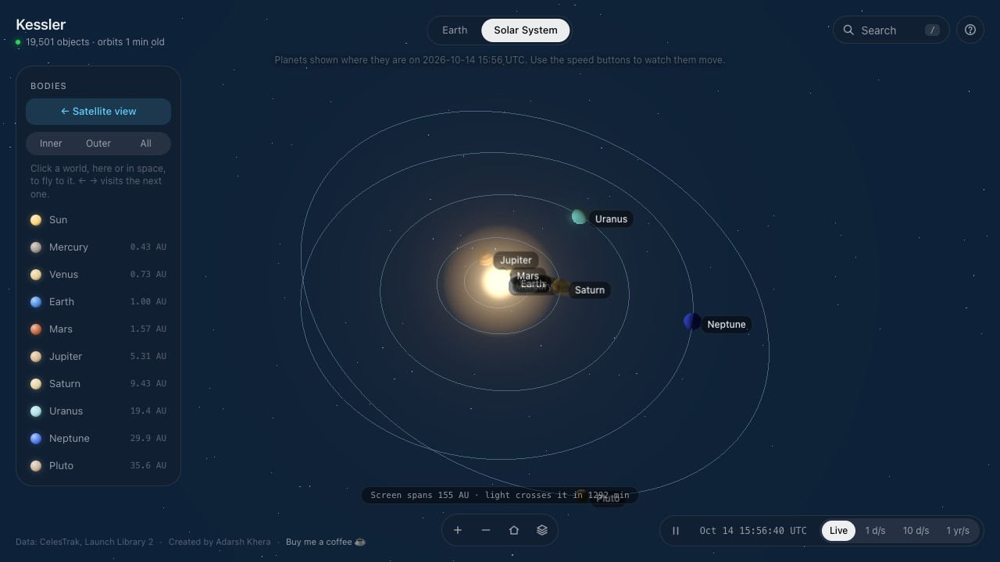
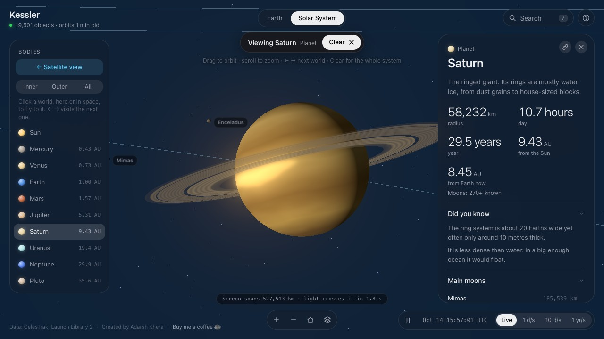
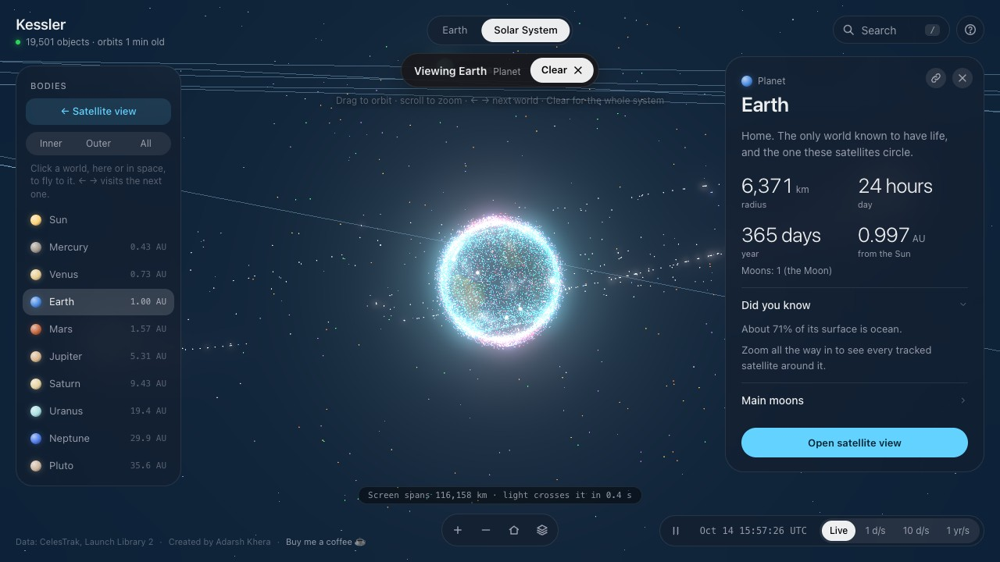

Planet positions come from published orbital elements and are checked in tests against where the planets really are. Spin axes use each body's real pole direction, so Saturn's rings and every night side are geometrically right. Everything is placed relative to whatever you are looking at, which keeps it steady from Earth orbit to Neptune.

## Measured, inferred, modelled, estimated

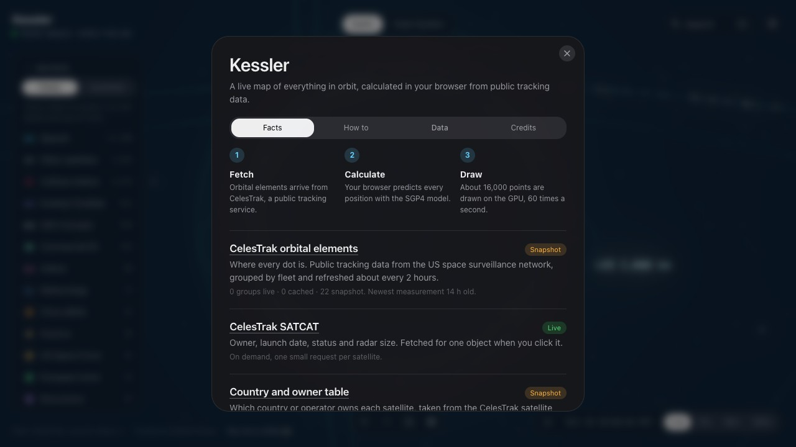

- **Measured:** orbits, owners, launch times, planet positions.
- **Inferred:** what a satellite is for (from name, fleet and orbit, and labelled).
- **Modelled:** the health bars (nobody publishes real health).
- **Estimated:** close passes (public orbits are good to about a kilometre).

## On a phone

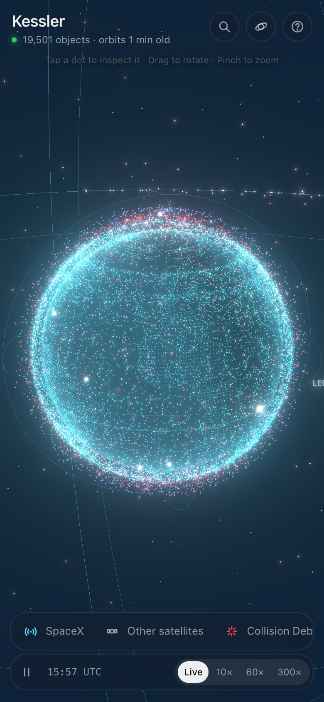 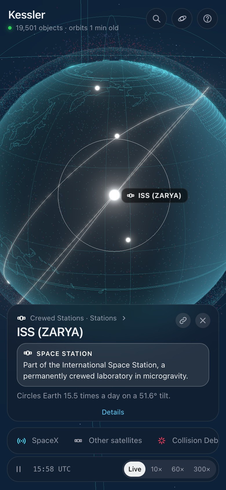 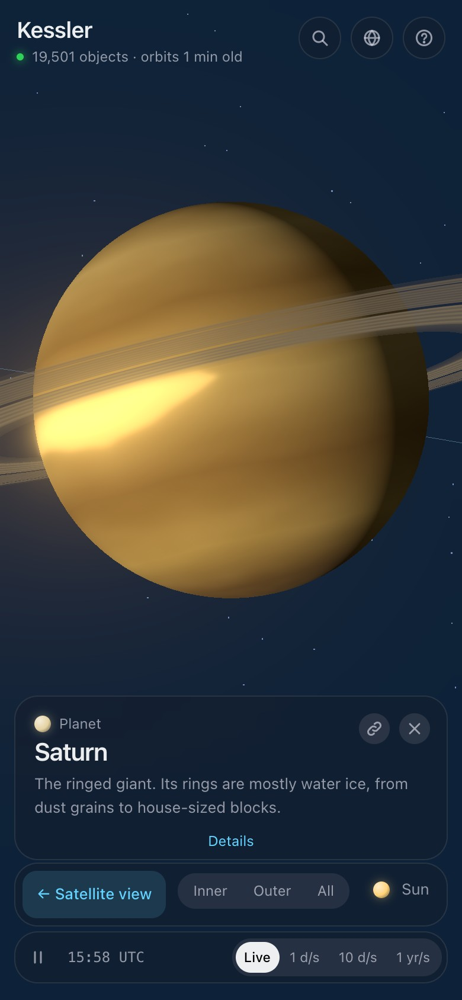

## How it is built

TypeScript, Vite and three.js, with the SGP4 orbit maths in Web Workers. No UI framework on purpose. 71 unit tests, 7 Playwright browser tests, ESLint and CI on every push. Separate review agents found real bugs along the way. MIT licence.

## Honestly

Phone layouts are tested in an emulator, not on real devices. The 3D itself is checked by eye. The offline data copy is limited by the provider's download rules.
